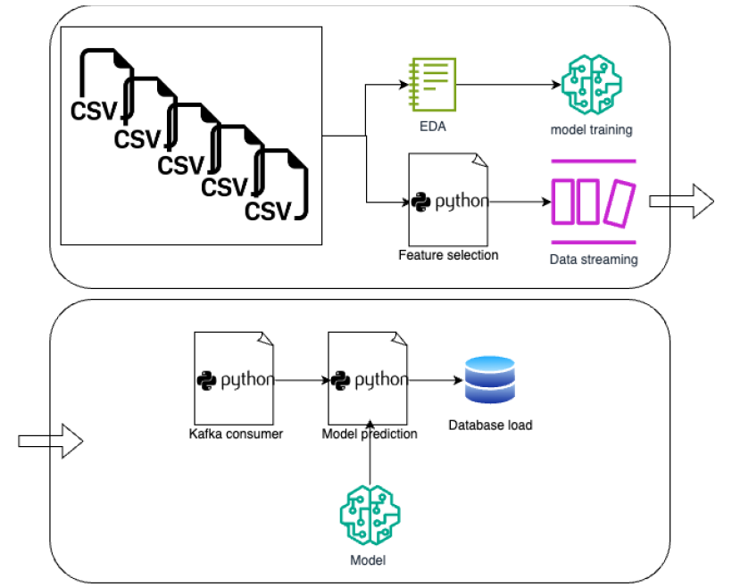
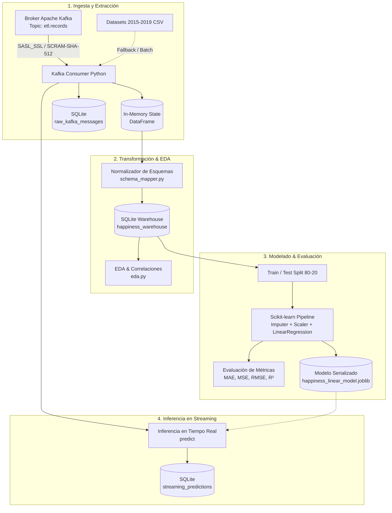
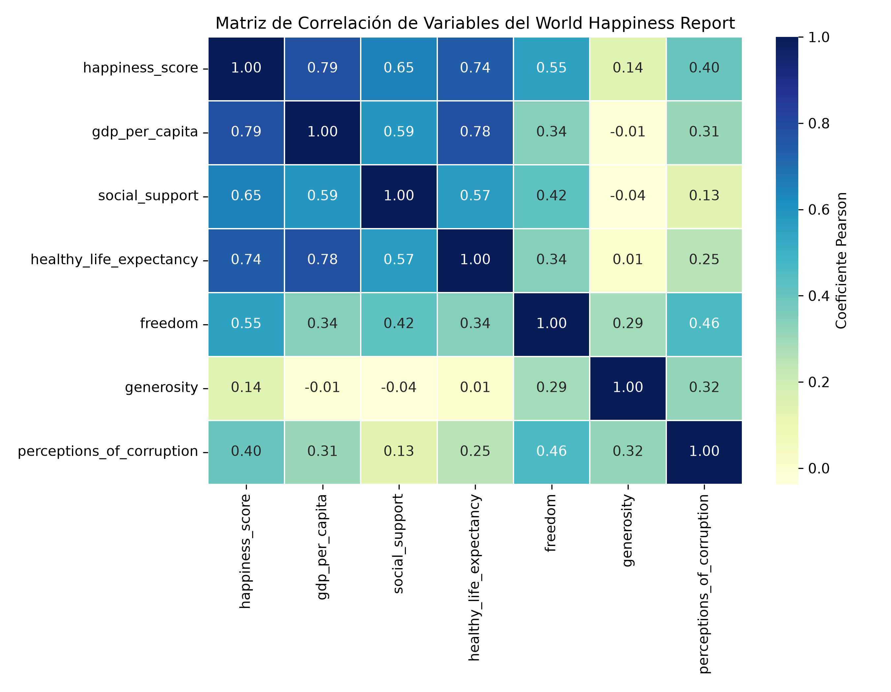
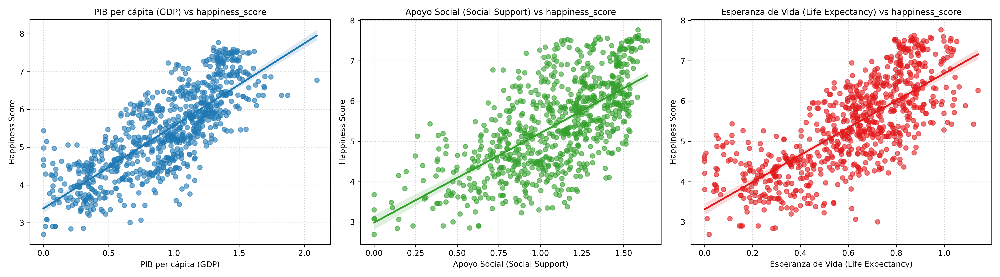
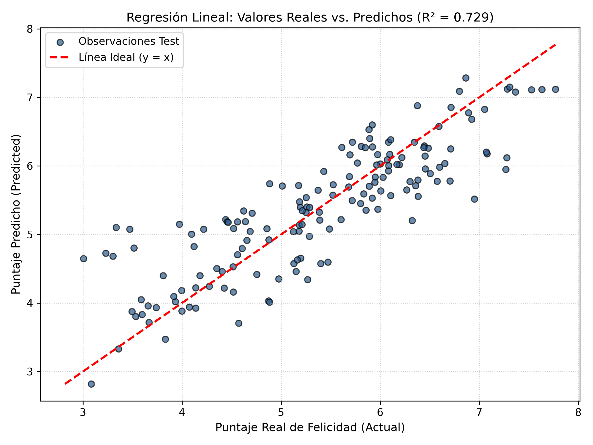
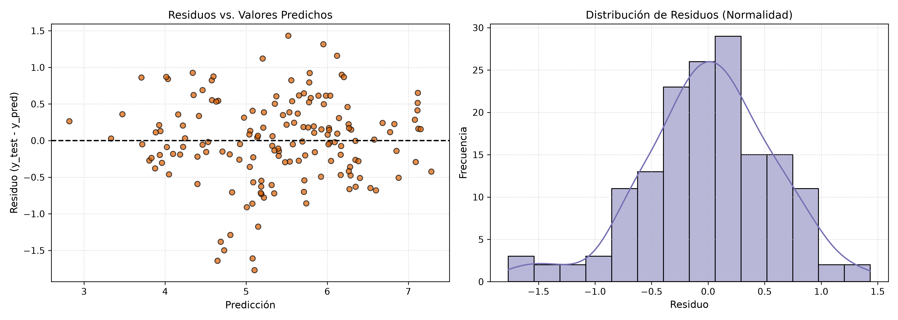

# ETL Streaming Pipeline & Machine Learning: World Happiness Analysis

**Tecnologías:** Python, Apache Kafka (`confluent-kafka`), Scikit-learn, SQLite, Pandas, Matplotlib, Seaborn, Jupyter Notebook.

---

## 1. Descripción del Proyecto

Implementación de una canalización integral que integra **procesamiento por lotes**, **data streaming en tiempo real con Apache Kafka** y **Machine Learning con Scikit-learn** para predecir el índice de felicidad (*Happiness Score*) a partir de registros históricos del **World Happiness Report** (2015 a 2019).

### Componentes Clave:
* **Extracción Streaming:** Consumidor implementado con `confluent-kafka` con autenticación `SASL_SSL` (`SCRAM-SHA-512`) conectado al broker Kafka, con fallback de simulación local continua.
* **Persistencia Relacional (SQLite):** Almacenamiento en `db/happiness.db` segregando eventos crudos (`raw_kafka_messages`), registros consolidados (`happiness_warehouse`) y resultados inferidos en streaming (`streaming_predictions`).
* **Transformación y EDA:** Armonización de esquemas heterogéneos entre años (2015-2019), imputación de valores faltantes y análisis estadístico multivariable.
* **Modelo Predictivo:** Pipeline de Scikit-learn (`SimpleImputer` + `StandardScaler` + `LinearRegression`), blindado contra fuga de información (*data leakage*), contrastado con un modelo no lineal (*Random Forest*) y evaluado con métricas estándar ($MAE$, $MSE$, $RMSE$, $R^2$ y $R^2$ Ajustado).

---

## 2. Arquitectura del Sistema

### 2.1 Diagrama de Arquitectura


### 2.2 Flujo de Datos


---

## 3. Estructura del Repositorio

```text
├── README.md                          # Documentación técnica del proyecto
├── Workshop_003_ETL.ipynb             # Notebook interactivo con ejecución y evidencias
├── requirements.txt                   # Dependencias de Python
├── run_pipeline.py                    # Script ejecutable CLI para correr el flujo completo
├── .env.example                       # Plantilla de variables de entorno
├── .gitignore                         # Exclusiones de Git
├── assets/
│   └── architecture_diagram.png       # Diagrama visual de la arquitectura
├── db/
│   └── happiness.db                   # Base de datos SQLite
├── models/
│   └── happiness_linear_model.joblib  # Pipeline de Machine Learning serializado
├── reports/
│   ├── metrics.json                   # Métricas numéricas de evaluación
│   ├── eda_summary.json               # Resumen estadístico de las variables
│   └── figures/                       # Gráficas generadas automáticamente
│       ├── eda_correlation_matrix.png
│       ├── eda_target_distribution.png
│       ├── eda_key_relationships.png
│       ├── eda_yearly_trend.png
│       ├── model_predictions_vs_actual.png
│       ├── model_residuals_plot.png
│       └── feature_importance.png
├── src/
│   ├── __init__.py
│   ├── config.py                      # Configuración central y constantes
│   ├── schema_mapper.py               # Mapeo y normalización de esquemas 2015-2019
│   ├── database.py                    # Gestión de tablas y queries en SQLite
│   ├── train_model.py                 # Entrenamiento, validación y exportación de modelos
│   ├── eda.py                         # Generación del EDA y visualizaciones
│   └── kafka_consumer.py              # Consumidor de streaming e inferencia en vivo
└── data/
    └── raw/                           # Datasets originales (2015.csv a 2019.csv)
```

---

## 4. Normalización de Esquemas Heterogéneos

Los 5 archivos anuales (2015-2019) contienen diferencias en sus nomenclaturas. A continuación se resume la tabla de equivalencias implementada en `src/schema_mapper.py`:

| Variable Canónica | Nombres en 2015 - 2016 | Nombres en 2017 | Nombres en 2018 - 2019 |
| :--- | :--- | :--- | :--- |
| **`country`** | `Country` | `Country` | `Country or region` |
| **`happiness_score`** *(Target)* | `Happiness Score` | `Happiness.Score` | `Score` |
| **`gdp_per_capita`** | `Economy (GDP per Capita)` | `Economy..GDP.per.Capita.` | `GDP per capita` |
| **`social_support`** | `Family` | `Family` | `Social support` |
| **`healthy_life_expectancy`** | `Health (Life Expectancy)` | `Health..Life.Expectancy.` | `Healthy life expectancy` |
| **`freedom`** | `Freedom` | `Freedom` | `Freedom to make life choices` |
| **`generosity`** | `Generosity` | `Generosity` | `Generosity` |
| **`perceptions_of_corruption`** | `Trust (Government Corruption)` | `Trust..Government.Corruption.` | `Perceptions of corruption` |

### Justificación de la Estrategia y Limitaciones
* **Decisión:** Se preservaron las **6 dimensiones explicativas fundamentales** compartidas en todos los informes junto con la variable temporal `year`, descartando columnas no homologables (como intervalos de confianza, ranking o residuo de distopía).
* **Imputación:** Se detectó un único valor faltante en `perceptions_of_corruption` (Emiratos Árabes Unidos en 2018). Se maneja mediante la mediana utilizando `SimpleImputer` dentro del pipeline de Scikit-learn para prevenir fuga de información (*data leakage*).
* **Limitaciones:** Ligeras variaciones metodológicas en las preguntas de encuestas entre años (por ejemplo, la transición de apoyo familiar a apoyo social en 2018).

---

## 5. Análisis Exploratorio de Datos (EDA)

Del análisis sobre los 782 registros consolidados se identifican los siguientes patrones:
1. **Factores con mayor correlación lineal:**
   * **PIB per cápita ($r = 0.79$):** Predictor principal del índice de felicidad.
   * **Esperanza de vida saludable ($r = 0.78$):** Relación lineal positiva alta.
   * **Apoyo social ($r = 0.65$):** Componente central en el bienestar subjetivo.
2. **Factores con menor impacto lineal:**
   * **Generosidad ($r = 0.14$):** Correlación lineal débil respecto al puntaje global.
   * **Percepción de corrupción ($r = 0.40$):** Relevante principalmente en países con niveles muy altos de bienestar.
3. **Distribución de la variable objetivo:** Distribución normal aproximada con media de $5.38$ y desviación estándar de $1.13$.




---

## 6. Modelo de Machine Learning y Resultados

### 6.1 Estrategia de Modelado
* **Prevención de Data Leakage:** El escalador (`StandardScaler`) y el imputador (`SimpleImputer`) están contenidos dentro de un objeto `Pipeline` de Scikit-learn, garantizando que el ajuste estadístico se calcule exclusivamente sobre el conjunto de entrenamiento (80%) y se proyecte sobre el conjunto de prueba (20%).
* **Algoritmo Principal:** **Regresión Lineal Múltiple**, debido a su interpretabilidad directa, alineación con los modelos econométricos y bajo costo computacional para streaming.
* **Modelo de Comparación:** **Random Forest Regressor (100 estimadores)** para contrastar relaciones no lineales.

### 6.2 Métricas de Desempeño en Test Set (157 muestras)

| Métrica | Definición | Regresión Lineal | Random Forest |
| :--- | :--- | :---: | :---: |
| **MAE** | Error Absoluto Medio | **0.4415** | 0.3920 |
| **MSE** | Error Cuadrático Medio | **0.3295** | 0.2562 |
| **RMSE** | Raíz del Error Cuadrático Medio | **0.5740** | 0.5061 |
| **$R^2$** | Coeficiente de Determinación | **0.7291** | 0.7894 |
| **$R^2$ Ajustado** | $R^2$ penalizado por $p=6$ predictores | **0.7183** | 0.7810 |

### 6.3 Coeficientes Estandarizados (Regresión Lineal)
* **Intercepto ($\beta_0$):** `5.3766`
* **`gdp_per_capita`:** `+0.4382` (Mayor impacto positivo)
* **`healthy_life_expectancy`:** `+0.2563`
* **`freedom`:** `+0.2249`
* **`social_support`:** `+0.2170`
* **`perceptions_of_corruption`:** `+0.1282`
* **`generosity`:** `+0.0585`




---

## 7. Data Streaming con Apache Kafka

El módulo `src/kafka_consumer.py` gestiona la suscripción al topic `etl.records` en el broker:
* **Host:** `kafka-classroom-2026.westus.cloudapp.azure.com:9092`
* **Protocolo:** `SASL_SSL`
* **Mecanismo:** `SCRAM-SHA-512`
* **Usuario:** `classroom-students`
* **Group ID:** `jhoan-hurtado`
* **Certificado SSL:** `certifi.where()`

### Inferencia en Tiempo Real
A medida que se recibe cada evento:
1. Se almacena el mensaje crudo en `raw_kafka_messages` en SQLite para trazabilidad y auditoría.
2. Se normalizan sus campos al esquema unificado.
3. El pipeline serializado (`models/happiness_linear_model.joblib`) genera la predicción inmediata `predicted_happiness_score`.
4. El registro enriquecido se persiste en `streaming_predictions` en SQLite.

---

## 8. Guía de Ejecución

### 8.1 Requisitos Previos
* Python 3.10 o superior.
* Entorno virtual recomendado.

### 8.2 Instalación
```bash
# 1. Clonar o ubicarse en el directorio del proyecto
cd https://github.com/JhoanHurtado/Workshop03

# 2. Crear y activar entorno virtual
python3 -m venv .venv
source .venv/bin/activate

# 3. Instalar dependencias
pip install -r requirements.txt
```

### 8.3 Configuración de Kafka (Opcional)
Cree un archivo `.env` o exporte la variable de entorno con las credenciales correspondientes:
```bash
export KAFKA_SASL_PASSWORD="su_contrasena_aqui"
```

### 8.4 Ejecución del Pipeline Completo
Para ejecutar entrenamiento, EDA, generación de figuras e inferencia en streaming:
```bash
python run_pipeline.py
```

*Si no se configuran credenciales remotas de Kafka, el sistema activa automáticamente la simulación de streaming local con los datasets provistos, validando el ciclo de vida completo.*

### 8.5 Ejecución del Notebook
Inicie Jupyter Notebook para interactuar con el flujo:
```bash
jupyter notebook Workshop_003_ETL.ipynb
```
O cargarlo directamente en **Google Colab**.

---

## 9. Conclusiones y Discusión

1. **Alineación Teórica:** El modelo lineal valida que el ingreso per cápita, la esperanza de vida saludable y la libertad de elección son los factores con mayor peso para explicar el bienestar subjetivo ($R^2 \approx 73\%$).
2. **Eficiencia en Streaming:** El acoplamiento entre un consumidor en Python y un modelo serializado con `joblib` permite latencias de inferencia de sub-milisegundos por mensaje.
3. **Mantenibilidad:** El uso de SQLite y estructuras desacopladas en `src/` garantiza simplicidad operativa, portabilidad y reproducibilidad inmediata sin dependencias complejas de infraestructura externa.
